# Digital Assignment 3: Scaling and Securing College-Events-hub

**Course:** BACSE344 Cloud Infrastructure and Architecture (C1 slot)
**Application (from DA1):** College-Events-hub, a college events portal. Clubs publish events, students register (email OTP), and organisers approve registrations.
**Repository branch:** https://github.com/VedantKaware7/College-events-hub/tree/assignment-3

| DA1 component | Technology / service |
|---|---|
| Frontend | React 18 + Vite, Render Static Site `college-events-hub.onrender.com` (and an nginx container locally) |
| Backend | Node.js + Express REST API, Docker image, Render Web Service `college-events-hub-api2` |
| Database | MongoDB Atlas `cluster0` (free M0 tier) |
| CI/CD | GitHub Actions to GHCR to Render deploy hooks |
| Email | Brevo HTTPS API (OTP mails) |

All DA3 runs use the **same Atlas cluster** with a separate database, `college_events_hub_da3` (selected through the new `MONGO_DB_NAME` variable), so the live DA1 data in the `test` database is never touched.

Raw output for every table below is in [`docs/da3-results/`](da3-results/). The scripts that produce it are in [`scripts/da3/`](../scripts/da3/).

---

## Question 1: Scale the application

### 1(a) Peak-demand situation and three instances behind Nginx

**Peak demand: fest registration opening.** When a college fest (e.g. *TechFest*) announces that "registrations open at 10:00 AM", most of the campus (several thousand students) opens the portal within the same minute. Seats are limited and first-come-first-served, so students keep refreshing the event list to watch `seatsLeft`. Without scaling, a single small API instance either queues requests for seconds or crashes, exactly when the college most needs it up.

**Hardest-hit API: `GET /api/events`.** It is public (no login needed, so every visitor hits it), it is the landing page, and it is re-fetched on every refresh. Each call queries the events collection and *populates* the organiser (2 database round-trips) before serialising every event to JSON. Registration (`POST /api/registrations`) is far rarer, because each student registers once and only after an email OTP.

**Implementation** ([`docker-compose.lb.yml`](../docker-compose.lb.yml), [`nginx/lb.conf`](../nginx/lb.conf)):

| Container | Image | Port (host to container) | Role |
|---|---|---|---|
| `api1`, `api2`, `api3` | `ceh-server:da3` (built from `server/Dockerfile`) | 5001/5002/5003 to 5000 | Express API replicas, each `INSTANCE_NAME`-tagged, 0.1 CPU / 512 MB (= Render free instance) |
| `ceh-lb` | `nginx:1.29-alpine` | 8081 to 80 | Load balancer, round-robin `upstream ceh_api` |
| `client` | built from `client/Dockerfile` | 8090 to 80 | React app; its `/api` is proxied to `ceh-lb` |
| MongoDB Atlas | `cluster0`, DB `college_events_hub_da3` | 27017 (TLS) | Shared cloud database for all replicas |

Code changes that support this:
- Every response carries an `X-Instance` header, and `/api/health` reports `instance` ([`server/app.js`](../server/app.js)).
- The servers shut down gracefully on SIGTERM ([`server/server.js`](../server/server.js)).
- `MONGO_DB_NAME` selects the database.

```bash
docker compose -f docker-compose.lb.yml up --build -d
docker compose -f docker-compose.lb.yml run --rm --no-deps api1 node seed.js
scripts/da3/distribution.sh 30
```

**Result: requests are spread evenly across all three instances** ([`q1a-distribution.txt`](da3-results/q1a-distribution.txt)):

| Instance | Requests served (of 30) |
|---|---|
| api1 | 10 |
| api2 | 10 |
| api3 | 10 |

```
{"status":"ok","db":"connected","instance":"api1",...}
{"status":"ok","db":"connected","instance":"api2",...}
{"status":"ok","db":"connected","instance":"api3",...}
"GET /api/events HTTP/1.1" 200 upstream=172.19.0.4:5000 instance=api1 rt=0.043
"GET /api/events HTTP/1.1" 200 upstream=172.19.0.3:5000 instance=api2 rt=0.045
"GET /api/events HTTP/1.1" 200 upstream=172.19.0.2:5000 instance=api3 rt=0.047
```

The upstream uses `zone ceh_api 64k;` so all nginx worker processes share one round-robin counter. Without it each worker keeps its own counter, and the first test gave an uneven 14/9/7 split.

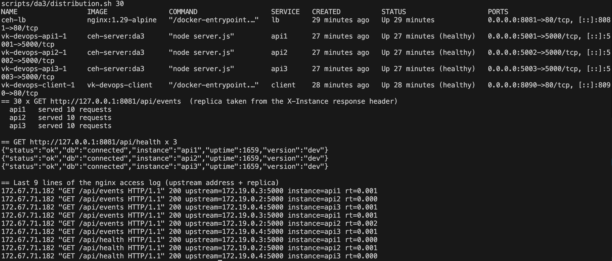
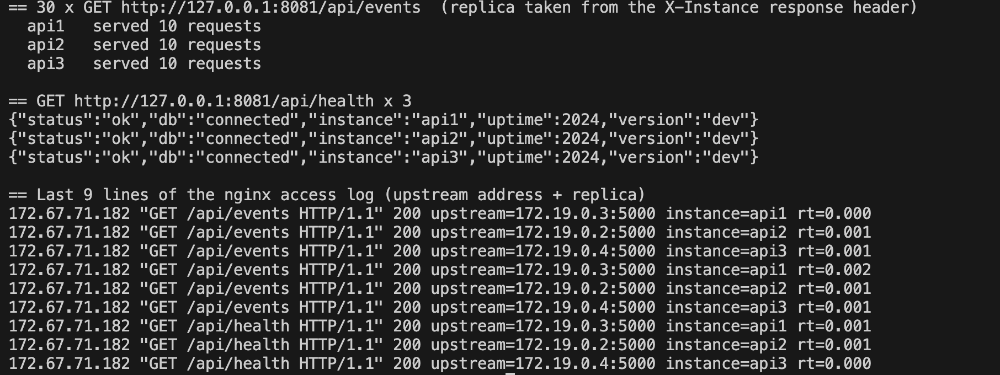

### 1(b) Load test: 1 instance vs 3 instances

- **Tool:** ApacheBench 2.3, `ab -n 1000 -c 50 http://127.0.0.1:8081/api/events`. Same tool, same 1,000 requests and the same concurrency (50) for both setups.
- **Both setups go through the same nginx.** The 1-instance run uses [`nginx/lb-single.conf`](../nginx/lb-single.conf) (upstream = `api1` only, with `api2`/`api3` stopped).
- **Procedure:** each setup gets a 1,000-request warm-up, then 5 measured runs. The tables report the median. Script: [`scripts/da3/loadtest.sh`](../scripts/da3/loadtest.sh).
- Q1 was measured before the Q2(c) image hardening, with the same API code for `GET /api/events`.

| Setup | Requests per second (median) | Mean response time (median) | Failed requests |
|---|---|---|---|
| 1 instance | **186.33 req/s** | **268.3 ms** | 0 / 1000 |
| 3 instances | **429.34 req/s** | **116.5 ms** | 0 / 1000 |
| **Improvement** | **2.30× throughput** | **56.6 % lower response time** | |

All 5 runs ([`q1b-summary.txt`](da3-results/q1b-summary.txt)):

| Run | 1 instance (req/s, ms) | 3 instances (req/s, ms) |
|---|---|---|
| 1 | 115.02 / 434.7 | 429.34 / 116.5 |
| 2 | 154.62 / 323.4 | 336.17 / 148.7 |
| 3 | 228.95 / 218.4 | 578.05 / 86.5 |
| 4 | 209.04 / 239.2 | 438.79 / 113.9 |
| 5 | 186.33 / 268.3 | 201.06 / 248.7 |

**Why it is not exactly 3×.** All three replicas share the same laptop, the same nginx, the same load generator and the same Atlas database. Docker's 0.1-CPU limit is enforced in 100 ms time slices, which makes individual runs noisy (hence the 5 runs and the median).

**What we found on the way: the database was the first bottleneck.** The first measurement (no caching, [`q1b-nocache-summary.txt`](da3-results/q1b-nocache-summary.txt)) gave the same result for both setups:

| Setup (no cache) | req/s (median) | Mean response time (median) |
|---|---|---|
| 1 instance | 62.37 | 801.7 ms |
| 3 instances | 62.27 | 802.9 ms |

During that run the replicas used only 7–12 % CPU ([`q1b-nocache-docker-stats.txt`](da3-results/q1b-nocache-docker-stats.txt)). Latency rose from about 45 ms (unloaded) to about 800 ms because every request waited on the **shared free-tier Atlas cluster, which caps throughput**. Adding API instances cannot help when all of them queue on the same database.

The fix, which is what the 1(b) table measures, is a **5-second in-process micro-cache for the event list** in [`eventController.listEvents`](../server/controllers/eventController.js):
- During the 10 AM rush, thousands of identical reads become one DB query per filter, per replica, every 5 s.
- Concurrent cache misses share the same in-flight query ("single-flight"), so cache expiry doesn't cause a stampede of 50 simultaneous DB queries.
- Event create, update and delete clear the cache.
- A 5 s staleness in `seatsLeft` is acceptable for a listing page. Registration itself always checks seats against the database.

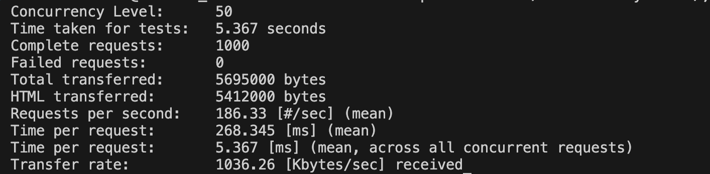
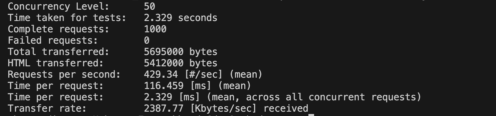

### 1(c) Stopping one instance during the load test

**Procedure** ([`scripts/da3/failover.sh`](../scripts/da3/failover.sh)):
- Run `ab -r -s 90 -n 5000 -c 50 /api/events`.
- 3 seconds in, run `docker compose stop api2`.
- `-s 90` lets `ab` wait out nginx's 60-second default connect timeout, so every request is counted.

| Nginx configuration | Complete | Failed requests | Non-2xx (502) | Result |
|---|---|---|---|---|
| **Before:** [`lb-basic.conf`](../nginx/lb-basic.conf), plain round-robin, `proxy_next_upstream off` | 5000 | **53** | 53 | ❌ 53 students get "502 Bad Gateway" |
| **After:** [`lb.conf`](../nginx/lb.conf), failover + retry | 5000 | **0** | 0 | ✅ no request fails |

- **Before** ([`q1c-basic.txt`](da3-results/q1c-basic.txt)): requests already sent to `api2` were reset as it stopped. Requests routed to it afterwards got `connect() failed (111: Connection refused)`. With no retry, each of them went back to the student as a 502.
- In an earlier run without the longer `ab` timeout, 8 requests were sent to `api2`'s IP after the container had left the network. They hung for nginx's 60 s default connect timeout, and `ab` aborted the whole run.

**The "after" configuration that makes no request fail:**

```nginx
upstream ceh_api {
    zone ceh_api 64k;                                  # failure state shared by all workers
    server api1:5000 max_fails=1 fail_timeout=10s;     # 1 failure takes a replica out for 10 s
    server api2:5000 max_fails=1 fail_timeout=10s;
    server api3:5000 max_fails=1 fail_timeout=10s;
    keepalive 32;
}
location /api/ {
    proxy_connect_timeout 2s;                          # don't wait 60 s on a dead replica
    proxy_next_upstream error timeout http_502 http_503 http_504;   # retry on another replica
    proxy_next_upstream_tries 3;
    proxy_next_upstream_timeout 10s;
}
```

Together with the API's graceful SIGTERM shutdown (it finishes in-flight requests before exiting):
- Failures are handled inside nginx: requests to the stopped replica were retried on a healthy one (log lines with two upstream addresses), and the student still got `200`.
- The nginx log of the "after" run shows 5 retried requests: 3 from `api2` (stopped) and 2 transient resets from `api1` while it ran at its 0.1-CPU cap.

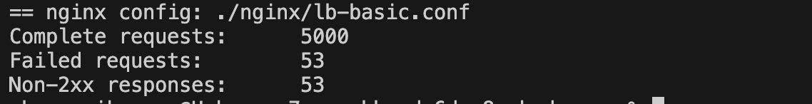
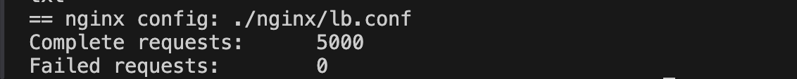

### 1(d) Architecture diagram (with cloud bursting)

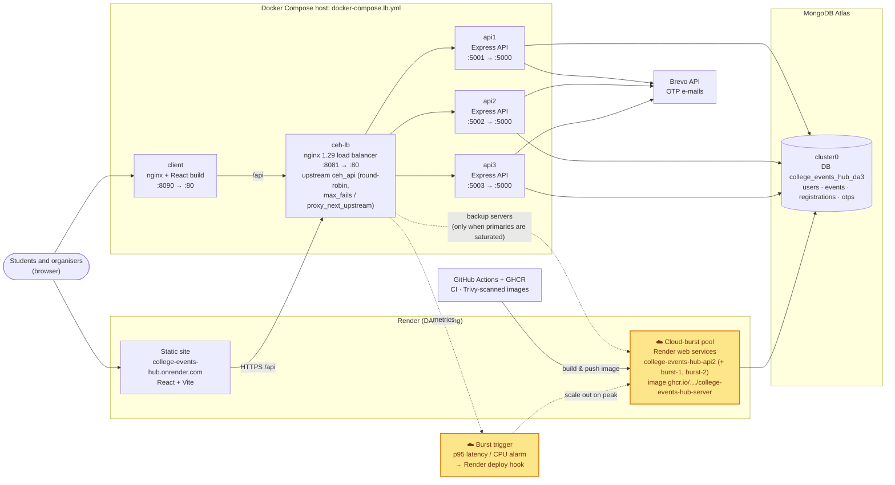

The **amber boxes** are the cloud-bursting extension; everything else is what we built and ran.

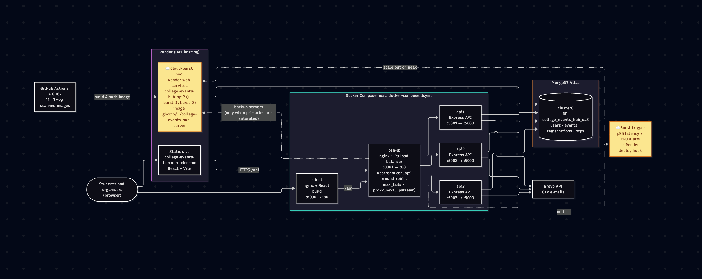

**How cloud bursting handles the 10 AM registration rush:**
1. **Normal days:** the three replicas behind `ceh-lb` (the college's own server, or one small VM) carry all traffic. Nginx lists the Render burst services as `backup` servers, so they receive nothing.
2. **When registrations open:** the burst trigger watches the nginx metrics (p95 latency > 500 ms or replica CPU > 80 % for 1 min). It calls the Render deploy hook to wake and scale the burst services. These run the same Trivy-scanned image from GHCR that GitHub Actions already builds.
3. **During the rush:** nginx overflows to the backup servers once the primaries start failing or timing out (`max_fails`/`proxy_next_upstream`). All replicas, local and burst, use the same Atlas cluster, so seat counts stay consistent and no data needs to be copied.
4. **After the rush** (registrations usually close within hours), the burst services scale back to zero and Render stops billing.

**Why cloud bursting for a college:**
- Demand is **predictable and very spiky**: a few registration days per semester, near-idle otherwise.
- Sizing permanent servers for the peak would waste money all year. Bursting keeps a small, cheap baseline and rents capacity only for those hours.
- The building blocks already exist from DA1: the Docker image, Render and the CI/CD to GHCR.
- Edge/fog computing suits latency-critical, data-local workloads like IoT. It would add little here, because students are on the same campus network and the data must be centralised anyway (one seat count per event).

---

## Question 2: Secure the application

### 2(a) Most sensitive data and salted password hashes

**Most sensitive data:**
- **Students' personal data:** full name, college e-mail, which events each student registers for (this reveals interests and club/cultural affiliations), registration status and **fee/payment status**.
- **Authentication secrets:** password hashes and TOTP secrets. If these leak, an attacker can take over accounts and read everything above.

**Implementation** ([`server/models/User.js`](../server/models/User.js)):
- A Mongoose `pre('save')` hook hashes every password with **bcrypt, cost 12, with a random per-user salt** before it reaches MongoDB, whatever code path saved it. Passwords that are already a bcrypt hash (`$2a$…`) are left untouched.
- `signup` and `seed.js` now go through this hook.
- DA1 already hashed at signup, but `seed.js` hashed one password once and reused that hash for every student, so all seeded students had **identical hashes (same salt)**. That leaks "these accounts share a password". It is now one salt per user.
- [`server/scripts/migrate-passwords.js`](../server/scripts/migrate-passwords.js) finds any plain-text password left in the collection and re-saves it through the hook.

**Before/after evidence** ([`q2a-password-migration.txt`](da3-results/q2a-password-migration.txt)): a legacy account imported from the college's old ERP spreadsheet is inserted with a plain-text password (the demo insert script bypasses the hook on purpose). Then the migration runs:

| Email | Before | After |
|---|---|---|
| legacy.student@college.edu | `Welcome@2024` | `$2a$12$/lrbruxNWmUu6x.xD7tkvex…` (bcrypt, cost 12) |
| student@college.edu | `$2a$12$HHT6KQspo2oi51yMgLA6MuRd…` | unchanged (already hashed) |
| aarav@college.edu | `$2a$12$LKxw2J8LJ0gnqV7itda8g.ci…` | unchanged (different salt, same password) |

```
Users: 12, already hashed: 11, plain text: 1
  hashed password for legacy.student@college.edu
```

The legacy student can still sign in with `Welcome@2024`, because login uses `bcrypt.compare`. The hash text is different on every run, because each one uses a new random salt.

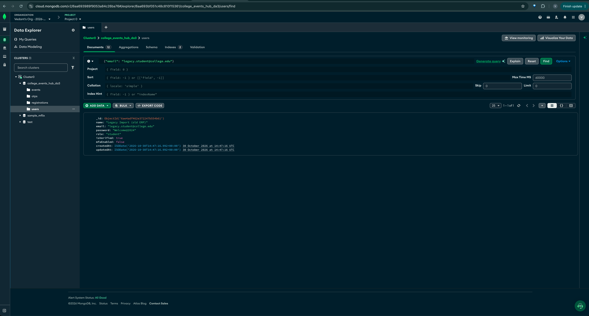
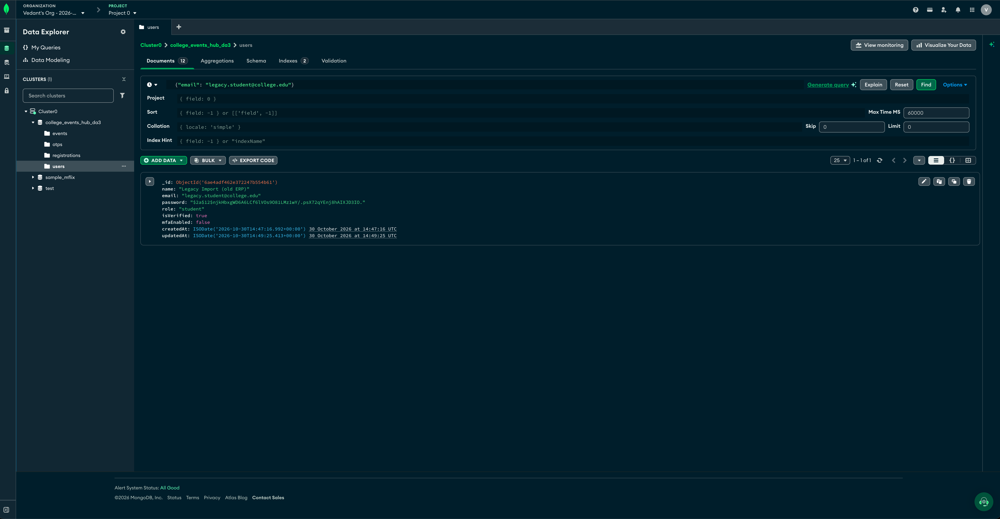

### 2(b) TOTP multi-factor authentication and role-restricted update/delete

**TOTP MFA** (works with Google Authenticator and Microsoft Authenticator; RFC 6238, SHA-1, 6 digits, 30 s):

| Step | Endpoint | What happens |
|---|---|---|
| Enrol 1 | `POST /api/auth/mfa/setup` 🔒 | Generates a secret (stored as `mfaPendingSecret`, `select:false`) and returns a QR code |
| Enrol 2 | `POST /api/auth/mfa/enable` 🔒 | First valid 6-digit code from the app switches `mfaEnabled` on |
| Login 1 | `POST /api/auth/signin` | Correct password + MFA on → `{mfaRequired, mfaToken}`. The `mfaToken` is a 5-minute JWT with `purpose: "mfa"` and is **not a session** |
| Login 2 | `POST /api/auth/mfa/verify` | `mfaToken` + code from the app → normal session JWT |

- **Frontend:** a third step on the sign-in page asks for the authenticator code ([`Login.jsx`](../client/src/pages/Login.jsx)). A "Two-factor authentication" card on the student and admin dashboards shows the QR code ([`MfaSetup.jsx`](../client/src/components/MfaSetup.jsx)).
- **Rate limit:** sign-in, OTP and MFA verification are limited to 20 attempts per 15 minutes per IP (`express-rate-limit`), against password guessing and code brute-forcing.

**Roles for this domain:**
- `student`: browse and register.
- `faculty`: an event coordinator, e.g. Prof. Meera Iyer, who runs the hackathon.
- `admin`: the student-activities office.

**Access rules:**
- `PUT /api/events/:id` and `DELETE /api/events/:id` require a valid session token **and** `requireRole('admin', 'faculty')` ([`middleware/auth.js`](../server/middleware/auth.js), [`routes/events.js`](../server/routes/events.js)).
- A faculty coordinator may only change **events they organise**; admin can change any.
- Creating events, approving registrations and viewing all students' registrations stay admin-only (least privilege).

**Evidence** ([`q2b-security-tests.txt`](da3-results/q2b-security-tests.txt), via the load balancer):

| Request | Result |
|---|---|
| `PUT /events/:id` **without token** | **401** `Authentication required` |
| `DELETE /events/:id` **without token** | **401** `Authentication required` |
| `PUT` with a forged token (bad signature) | **401** `Session expired, please sign in again` |
| `PUT` with a **student** token | **403** `Requires role: admin or faculty` |
| `DELETE` with a **student** token | **403** `Requires role: admin or faculty` |
| `PUT` with a **faculty** token on the admin's event | **403** `You can only edit events you organise` |
| `PUT` with a faculty token on their own event | 200 |
| `PUT` with an admin token | 200 |
| MFA enable with a wrong code | 400 `Invalid authenticator code` |
| MFA enable with the authenticator code | 200 `Two-factor authentication enabled` |
| Sign-in with password only (MFA on) | 200 `{"mfaRequired":true,"mfaToken":"…"}` (no session) |
| Using the `mfaToken` as a session on `PUT /events` | **401** `Sign-in not completed` |
| `mfa/verify` with a wrong code | 400 |
| `mfa/verify` with the authenticator code | 200 → session token |

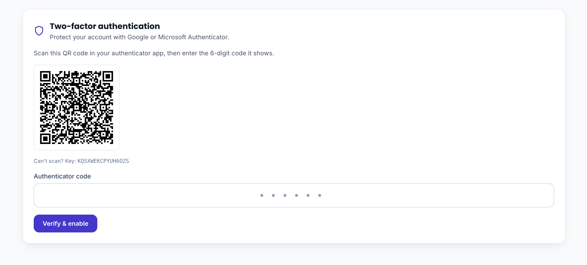
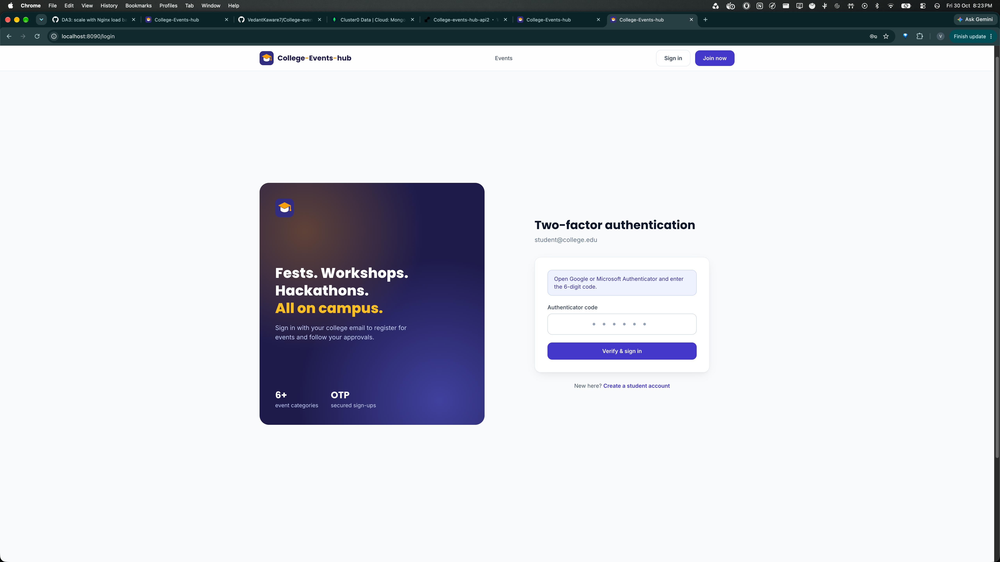
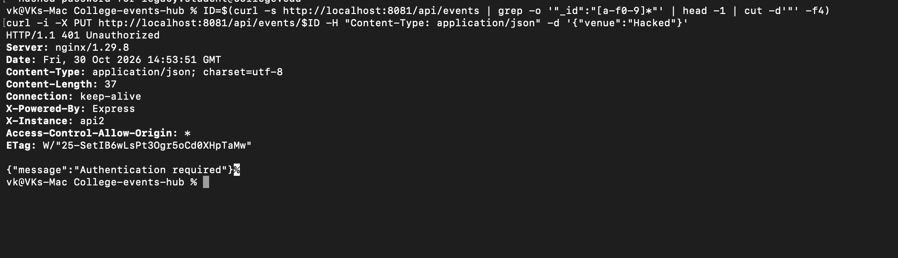
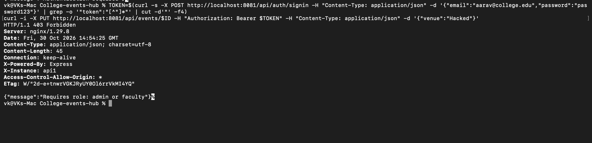

### 2(c) Trivy scan and image hardening

Scanner: **Trivy 0.69.3** (`aquasec/trivy:0.69.3`, image built 2026-03-03, which predates the compromised 0.69.4 releases of March 2026), `--severity CRITICAL,HIGH`.

| | Before (DA1 `server/Dockerfile`) | After (hardened `server/Dockerfile`) |
|---|---|---|
| Base image | `node:20-alpine` (Node 20 is end-of-life since April 2026) | build: `node:24-alpine` → runtime: **`alpine:3.23` + `node` binary only** |
| Package managers in image | npm, npx, yarn, corepack | **none** |
| OS packages | as shipped | `apk upgrade` (patched OpenSSL) |
| User | `node` | `node` (uid 1000, non-root, `nologin` shell) |
| App files | owned by root | owned by root, **not writable** by the app user |
| Runtime (Compose) | default | `read_only: true`, `cap_drop: [ALL]`, `no-new-privileges` |
| App dependencies | express 4.22.1, nodemailer 6.10.1 | express 4.22.3, proxy-addr 2.0.8, nodemailer 10.1.1 |
| **CRITICAL** | **2** | **0** |
| **HIGH** | **32** | **1** |
| Image size | 150 MB | 158 MB |

Before, by source ([`trivy-before.txt`](da3-results/trivy-before.txt)):
- **OS (Alpine):** 4 HIGH (OpenSSL `libssl3`/`libcrypto3`).
- **Node.js packages:** 2 CRITICAL (`proxy-addr`, `tar`) and 28 HIGH.
  - **1 CRITICAL and 21 HIGH** were in the npm copy bundled with the base image (`tar`, `brace-expansion`, `minimatch`, `glob`, `cross-spawn`, `sigstore`, `pacote`, `ip-address`), which the app never uses at runtime.
  - The rest were app dependencies: `proxy-addr` (CRITICAL), `nodemailer` ×5, `body-parser` and `path-to-regexp`.

After ([`trivy-after.txt`](da3-results/trivy-after.txt)): the only finding left is **1 HIGH, CVE-2026-111181 in `body-parser` 1.20.8** (a DoS via compressed request bodies).
- Its fix (1.20.9) was published on 2026-10-22, and we only adopt dependency versions that are at least 14 days old, a supply-chain precaution.
- It is **mitigated in code**: `express.json({ inflate: false })` rejects compressed request bodies, which the API never needs, so the vulnerable path is unreachable. It will be removed with a normal dependency update once 1.20.9 is past the 14-day window.

**About image size:**
- The runtime base itself is smaller: npm, yarn and corepack are gone.
- The total still grew by 8 MB, because Node 24's binary is larger than Node 20's and the new security libraries (TOTP, QR, rate limiting, nodemailer 10) were added.
- Removing npm by deleting it in a later layer of `node:24-alpine` gave 185 MB, because deleted files stay in the lower layer. Hence the switch to plain Alpine plus the node binary.

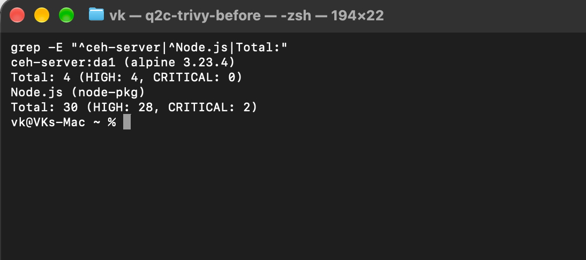
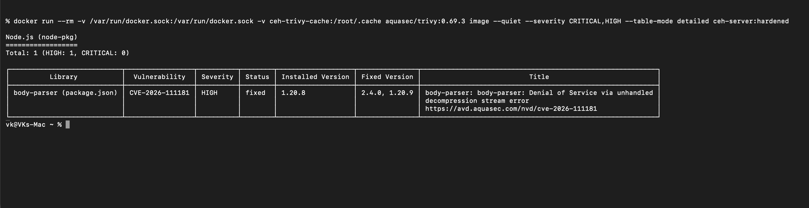
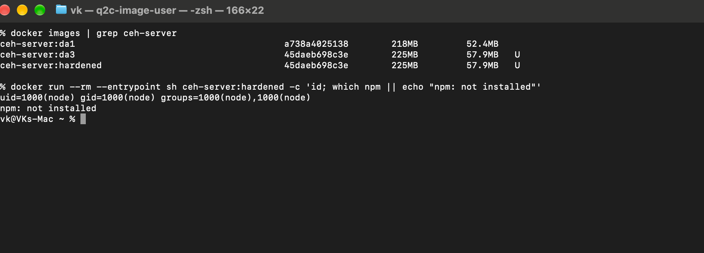

### 2(d) Threat agents, controls and regulation

| Threat agent | What they want / how | Controls implemented | Regulation requirement |
|---|---|---|---|
| **1. External attacker:** credential-stuffing bots and phishers using passwords leaked from other sites | Take over student or organiser accounts to harvest the student list (names, e-mails, payment status), or to edit or delete events | bcrypt-12 with per-user salts (a DB leak doesn't reveal passwords); **TOTP MFA** (a stolen password alone is not enough); login rate limit (20 / 15 min / IP); hardened, scanned image | **GDPR Art. 32(1):** implement "appropriate technical measures to ensure a level of security appropriate to the risk", including the ability to ensure the ongoing **confidentiality** of processing systems |
| **2. Malicious or curious insider:** a student, or a faculty coordinator exceeding their remit | A student edits or deletes a rival club's event; a coordinator changes another department's event; someone views other students' registrations | Server-side **role-based access control** (`requireRole`) on update/delete; faculty **ownership check**; registrations list admin-only; JWT signature verification; an MFA challenge token can't be used as a session | **GDPR Art. 5(1)(f):** "integrity and confidentiality": personal data must be protected "against unauthorised or unlawful processing" (and Art. 25, data protection by default: only those who need the data can access it) |

**Why GDPR applies:**
- The app processes **personal data of identifiable natural persons** (students' names, e-mails, activities and payment status). GDPR is the reference regulation for personal data in general.
- It applies directly whenever the college processes data of people in the EU, e.g. exchange or international students and applicants (Art. 3(2)).
- For an Indian college, the directly binding law is the **Digital Personal Data Protection Act 2023**. Section 8(5) requires the data fiduciary to "protect personal data … by taking reasonable security safeguards to prevent personal data breach", which is the same obligation as GDPR Art. 32.
- HIPAA does not apply: the app holds no health data.

---

## Files added or changed on branch `assignment-3`

| Area | Files |
|---|---|
| Scaling | `docker-compose.lb.yml`, `nginx/lb.conf`, `nginx/lb-basic.conf`, `nginx/lb-single.conf`, `nginx/client.conf`, `server/app.js` (X-Instance, trust proxy), `server/server.js` (graceful shutdown, `MONGO_DB_NAME`), `server/controllers/eventController.js` (micro-cache) |
| Passwords | `server/models/User.js` (bcrypt hook), `server/controllers/authController.js`, `server/seed.js` (per-user salts, faculty user), `server/scripts/migrate-passwords.js`, `server/scripts/insert-legacy-user.js` (demo only) |
| MFA + RBAC | `server/controllers/authController.js`, `server/routes/auth.js`, `server/middleware/auth.js`, `server/routes/events.js`, `client/src/pages/Login.jsx`, `client/src/context/AuthContext.jsx`, `client/src/components/MfaSetup.jsx`, dashboards |
| Hardening | `server/Dockerfile`, `server/package.json` / lockfile, `.github/workflows/*.yml` (Node 24) |
| Evidence | `scripts/da3/*.sh`, `docs/da3-results/*` |
